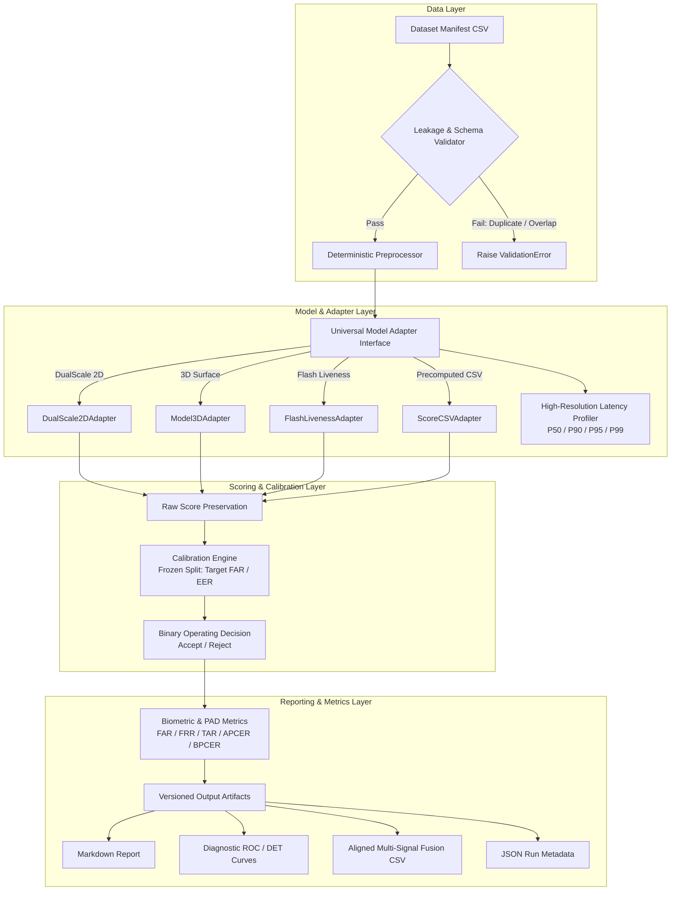
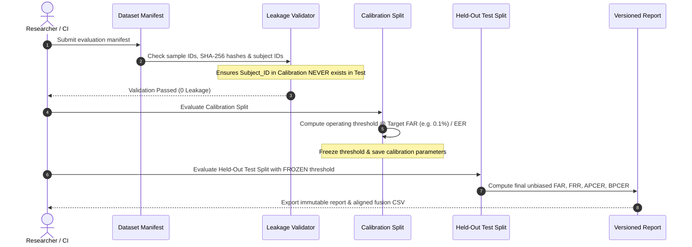
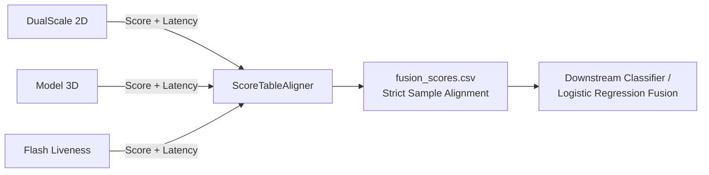

<div align="center">

# 🛡️ YellowSense UIDAI Contactless Fingerprint Benchmark Harness

**A production-grade, reproducible, model-agnostic evaluation framework for biometric and PAD evaluation.**

[](https://www.python.org/downloads/)
[](tests/)
[](https://www.iso.org/)
[](#)
[](#)

<p align="center">
  <a href="#-key-features">Key Features</a> •
  <a href="#-architecture-pipeline">Architecture</a> •
  <a href="#-quick-start">Quick Start</a> •
  <a href="#-dataset-manifest--scientific-partitioning">Manifest Schema</a> •
  <a href="#-cli-reference">CLI Reference</a> •
  <a href="#-multi-signal-fusion">Fusion Engine</a> •
  <a href="#-testing">Testing</a>
</p>

</div>

---

## 📌 Motivation & Problem Solved

In biometric and contactless fingerprint evaluation, different teammates frequently evaluate models using inconsistent one-off scripts, ad-hoc image normalization pipelines, unversioned datasets, and divergent threshold heuristics. This causes conflicting numbers across reports and creates the *"why do these tables disagree?"* problem.

**This benchmark harness establishes a single, repeatable, fixed evaluation pipeline:**
* ✅ **One Held-Out Test Set**: Strict manifest validation guarantees train/calibration/test split isolation with zero subject overlap.
* ✅ **One Scoring & Metric Pipeline**: All models pass through identical preprocessing, latency profiling, threshold calibration, and metric calculators.
* ✅ **Immutable Versioned Artifacts**: Every run automatically saves full environment metadata, git commit hashes, raw scores, threshold curves, and Markdown/JSON reports.

---

## 🏗️ Architecture Pipeline

### End-to-End Evaluation Workflow



---

## 🔬 Scientific Partitioning & Zero-Leakage Guarantee

To ensure scientific validity and comparability across all model updates, datasets are partitioned into strict, non-overlapping splits:



---

## ⚡ Key Features

* **Universal Model Adapters**: Standardized `BaseModelAdapter` abstraction supporting PyTorch checkpoints, ONNX runtimes, or precomputed score CSVs.
* **ISO/IEC 30107-3 PAD Compliance**: Native calculation of APCER, BPCER, ACER, and standard biometric figures (FAR, FRR, TAR@FAR, EER).
* **High-Precision Latency Profiling**: Captures warm-up cycles, P50, P90, P95, P99 inference latencies, memory footprint, and tail-latency outlier tracking.
* **Strict Multi-Signal Fusion Alignment**: Unifies multiple independent biometric signals (e.g., 2D ridge details, 3D shape, active flash reflection) by `sample_id` without missing rows or silent desynchronization.
* **Automatic Audit Metadata**: Captures CPU, GPU, OS, Python packages, Git commit hash, and config SHA-256 with every run.

---

## 🚀 Quick Start

### 1. Installation

```bash
# Clone the repository
git clone https://github.com/Rahulmahajan162003/Common-pipeline.git
cd Common-pipeline

# Install dependencies
pip install -r requirements.txt
```

### 2. Run All Tests

Verify harness integrity and reproducibility in seconds:

```bash
pytest
# Output: 30 passed in ~35s
```

### 3. Run a Benchmark

```bash
python -m benchmark_harness.cli run --config configs/benchmark_score_only.yaml
```

Generated artifacts and reports will be saved under:
```
results/<dataset_name>/run_<timestamp>_<uuid>/
├── report.md
├── summary.json
├── roc_curve.png
├── det_curve.png
├── score_distribution.png
└── latency_profile.png
```

---

## 💻 CLI Reference

The benchmark harness includes a command-line interface:

```bash
python -m benchmark_harness.cli [COMMAND] [OPTIONS]
```

| Command | Description | Example |
| :--- | :--- | :--- |
| `validate` | Validates manifest schema, file existence, and split isolation | `python -m benchmark_harness.cli validate -c configs/benchmark_single_finger.yaml` |
| `run` | Executes full benchmark pipeline and generates versioned reports | `python -m benchmark_harness.cli run -c configs/benchmark_single_finger.yaml` |
| `threshold` | Sweeps thresholds and analyzes calibration points (EER, Target FAR) | `python -m benchmark_harness.cli threshold -c configs/benchmark_single_finger.yaml` |
| `compare` | Compares metrics across multiple historical benchmark runs | `python -m benchmark_harness.cli compare -r results/run_A results/run_B -o results/diff.md` |
| `join-scores` | Strictly aligns multi-signal score CSVs on `sample_id` for fusion | `python -m benchmark_harness.cli join-scores -s ds=scores/ds.csv m3d=scores/3d.csv -o scores/fused.csv` |

---

## 📁 Repository Layout

```
.
├── benchmark_harness/             # Core benchmark framework
│   ├── adapters/                  # Pluggable model adapters (2D, 3D, Flash, CSV)
│   ├── metrics/                   # Biometric, PAD, and Latency metric engines
│   ├── preprocessing/             # Deterministic image transforms
│   ├── reporting/                 # Markdown/HTML reporters and diagnostic plots
│   ├── scoring/                   # Calibration, thresholding, and score alignment
│   ├── cli.py                     # CLI entry point
│   ├── config.py                  # YAML/JSON schema parser & validator
│   ├── manifest.py                # Manifest parser and container
│   ├── runner.py                  # End-to-end benchmark orchestrator
│   ├── validation.py              # Subject leakage and schema checks
│   └── versioning.py              # Environment and Git metadata capture
├── configs/                       # Ready-to-use YAML benchmark configs
│   ├── benchmark_single_finger.yaml
│   ├── benchmark_score_only.yaml
│   └── benchmark_multi_signal.yaml
├── datasets/                      # Manifests and synthetic test samples
│   ├── manifests/                 # Example CSV manifests
│   └── synthetic_data/            # Test images for unit testing
├── scores/                        # Precomputed scores for score-only evaluation
├── results/                       # Versioned benchmark execution artifacts
└── tests/                         # Automated test suite (30 unit & integration tests)
    └── benchmark/
```

---

## 🔗 Multi-Signal Fusion Pipeline

When evaluating multimodal signals (DualScale 2D + Model 3D + Flash Active Liveness), the harness automatically aligns raw scores on `sample_id`:



### Downstream Fusion Workflow:
1. **Train**: Train the fusion model strictly on samples with `split == 'calibration'`.
2. **Evaluate**: Evaluate the fused scores on samples with `split == 'test'`.
3. **No Leakage**: Preserves sample-level alignment and eliminates missing row mismatches.

---

## 🧪 Testing & Verification

The harness is backed by a unit and integration test suite:

```bash
# Run entire test suite
pytest -v

# Run reproducibility verification
pytest tests/benchmark/test_reproducibility.py

# Run manifest leakage verification
pytest tests/benchmark/test_manifest.py
```

---

## 🔒 Privacy & Biometric Data Safety

* **No Raw Image Leakage**: Raw biometric images and PII are never duplicated into benchmark result directories.
* **Anonymized Artifacts**: Output artifacts store only anonymized `sample_id` references, cryptographic hashes, numerical scores, latency values, and aggregate curves.
* **Git Safe**: Datasets and local run artifacts are excluded via `.gitignore`.

---

<div align="center">
  <sub>Developed for the <b>YellowSense UIDAI Contactless Fingerprint</b> project.</sub>
</div>
